# PCFM: Probabilistic Causal Foundation Model for Zero-Shot Multivariate Forecasting Under Topological Constraints

[](https://huggingface.co/software-competence-center-hagenberg/PCFM)
[](https://pytorch.org)
[](https://www.python.org)

PCFM is a pretrained **graph-conditioned time-series foundation model**. It
forecasts every variable of a multivariate system while respecting an
(optional) **causal graph with per-edge transport delays**, and it answers
**what-if questions**: overwrite an actuator's future with an intervention
plan, and the model predicts how the downstream variables react — zero-shot,
no fine-tuning.

<p align="center">
  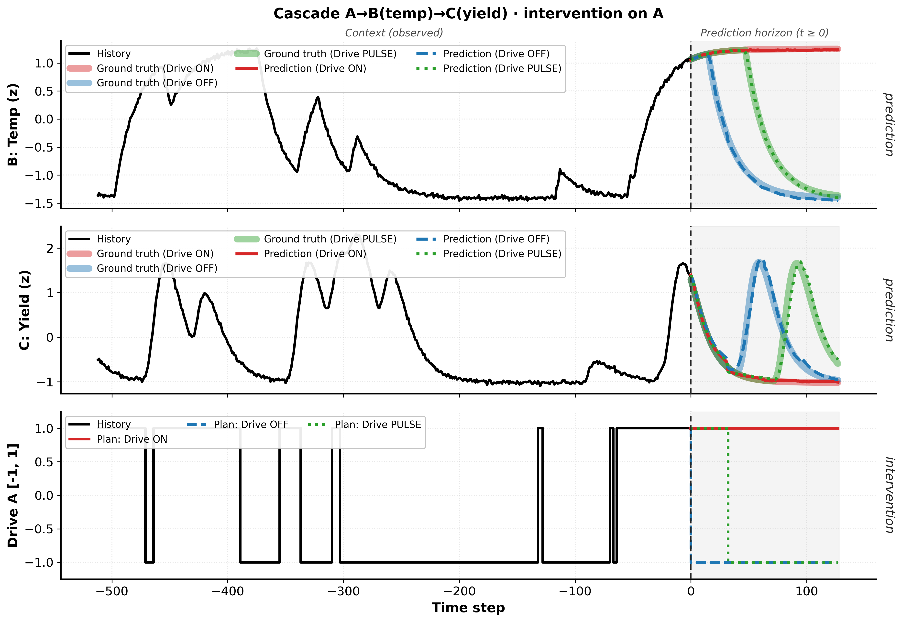
</p>
<p align="center"><i>Zero-shot what-if on a causal chain A → B → C: three different plans for
driver A (bottom) — the predicted responses of B and C (crisp lines) track the
ground-truth physics (light bands), including the non-monotonic yield peaks.</i></p>

**Contents**  [Highlights](#highlights) · [Benchmark](#benchmark) ·
[Getting started](#getting-started) · [Quickstart](#quickstart) ·
[What-if](#1-what-if--interventions-with-known-consequences) ·
[Causal graphs](#2-causal-graphs--ci--cd--cp--custom) ·
[Custom masks](#3-custom-masks--in-filling-and-beyond) ·
[DataFrame API](#4-dataframe-api--predict_df) ·
[Forecasting](#5-forecasting--with-and-without-a-predictable-future) ·
[API summary](#api-summary) · [Model card](#model-card)

## Highlights

- **One file.** The whole model lives in `model.py` with the checkpoint
  configuration hardcoded — install four small dependencies and go.
- **Forecasting + what-if in one API.** Point forecasts and 9 calibrated
  quantiles; interventions enter simply as known future values of a driver.
- **Graphs optional, in four flavors.** Fully connected (`"CD"`, default),
  channel-independent (`"CI"`), **estimated from your data** (`"CP"`), or your
  own edges with optional lags — even by column name.
- **Pandas-friendly.** A Chronos-style `predict_df` for long-format DataFrames
  with ids, timestamps, covariates, and multiple targets.
- **Pure PyTorch.** A hybrid architecture — transformer blocks for temporal
  dynamics, interleaved with graph message-passing layers that follow the
  causal edges and their delays. No `torch_geometric` required.

## Benchmark

On [fev-bench](https://github.com/autogluon/fev), PCFM ranks **among the top 3
of 16 evaluated forecasting foundation models** on both point accuracy (MASE)
and probabilistic accuracy (scaled quantile loss) — pairwise skill scores with
95% confidence intervals:

| MASE skill score | Scaled quantile loss skill score |
|---|---|
|  | 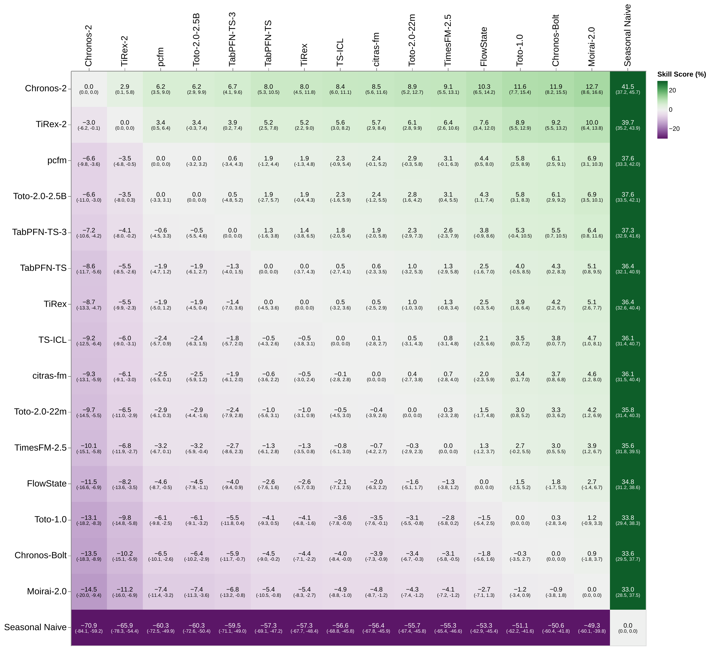 |

## Getting started

```bash
git clone https://github.com/software-competence-center-hagenberg/PCFM.git
cd PCFM
pip install -r requirements.txt

python example.py        # reproduces EVERY example figure + number below
python test_release.py   # self-contained test suite (no download needed)
```

The checkpoint (~211 MB, 53M parameters, `model.safetensors`) is downloaded
automatically from the
[Hugging Face Hub](https://huggingface.co/software-competence-center-hagenberg/PCFM)
on first use; a local path works too (`python example.py path/to/model.safetensors`).

Every figure and number in the sections below was produced by `example.py`
with the released checkpoint, on synthetic systems whose physics is known in
closed form — so each claim is reproducible with one command.

## Quickstart

```python
import numpy as np
from model import PCFMPredictor

model = PCFMPredictor.from_pretrained()       # or: from_pretrained("model.safetensors")

history = np.random.randn(3, 1024)            # [num_variables, time] — one system
median = model.forecast(history, prediction_length=128)          # [3, 128]
q9 = model.forecast(history, 128, return_quantiles=True)         # [3, 128, 9]
```

Or with DataFrames (Chronos-style, details [below](#4-dataframe-api--predict_df)):

```python
pred_df = model.predict_df(context_df, future_df=future_df, prediction_length=24,
                           quantile_levels=[0.1, 0.5, 0.9], id_column="id",
                           timestamp_column="timestamp", target="temp")
```

---

## Capability tour

The demo system is a valve → temperature loop with known physics: a binary
valve (encoded ±1) drives the temperature toward 20–80 °C through a
first-order lag with a **48-step transport delay** (protocol identical to the
accompanying dissertation's what-if suite: 4096-step context, 128-step
horizon, noise σ=0.5).

<p align="center">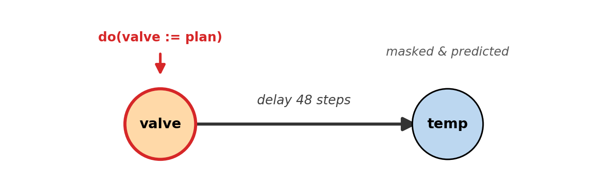</p>

```python
from example import make_valve_temp_window, LAG    # the physics described above
window = make_valve_temp_window()                  # [2, 4224]: node 0 valve, node 1 temp
history = window[:, :4096]
graph = [(0, 1, float(LAG))]                       # valve -> temp @ lag 48
```

### 1. What-if — interventions with known consequences

Write an intervention plan into the driver's future, mask the response, and
the model predicts the consequence:

```python
w = window.copy()
w[0, 4096:] = 1.0                                            # do(valve := ON)
recon = model.what_if(w, context_length=4096, masked_nodes=[1], graph=graph)
prediction = recon[1, 4096:]                                 # predicted temperature
```

<p align="center">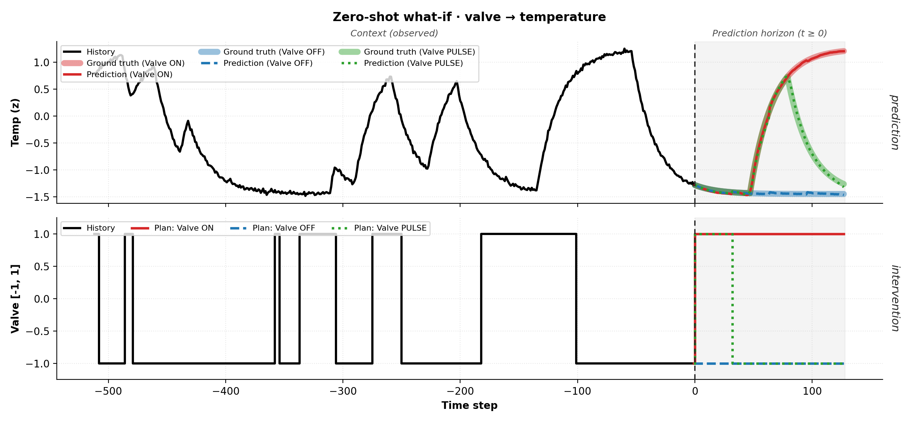</p>

The plan is known, the response is masked — and the predictions land on the
analytic physics: MAE **0.36 / 0.23 / 0.66 °C** for
the ON / OFF / PULSE plans on the 20–80 °C range, with the correct 48-step
onset delay and an intervention-effect error
(`mean|(pred_ON − pred_OFF) − (truth_ON − truth_OFF)|`) of **0.26 °C**.

### 2. Causal graphs — CI / CD / CP / custom

The `graph` argument is the same across the whole API:

| Value | Meaning |
|---|---|
| `"CI"` | Channel-independent: self-loops only, no cross-variable interaction. |
| `"CD"` | Channel-dependent: fully connected, zero lags. **Default.** |
| `"CP"` | Channel-partial: sparse graph + lags **estimated from data** (Granger + cross-correlation; needs scipy). |
| `[(src, dst, lag), ...]` | Custom tuples — indices in the tensor API, **column names** in `predict_df`; lag optional. |
| `[2, E]` array | Custom edge index; per-edge lags via `edge_lags=[...]` (optional). |

What these look like on the 10-variable demo system (orange = drivers, blue =
responses, red ring = the intervened variable):

<p align="center">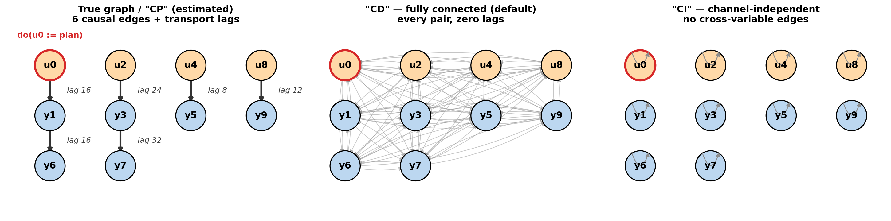</p>

With only two variables the modes barely differ — structure pays off in
**sparse multivariate systems**. `example.py` therefore runs the graph
comparison on the dissertation's 10-variable topology benchmark: four
mutually independent units, six causal edges, intervention on driver `u0`,
target `y1` (note the log scale on the error panel — CI is ~70× worse):

<p align="center">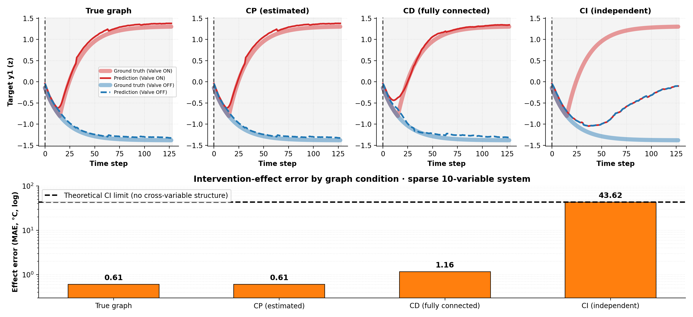</p>

| Graph condition | Intervention-effect error (MAE, °C) |
|---|---|
| True graph (+ true lags) | **0.61** |
| `"CP"` — estimated from the context | **0.61** |
| `"CD"` — fully connected | 1.16 |
| `"CI"` — no cross-variable edges | 43.62 (= theoretical limit) |

The estimated graph matches the oracle's intervention accuracy: the `"CP"`
estimator recovers **all six true edges with their transport delays** from the
4096-step context alone. Under `"CI"` the intervention cannot reach the target
by construction — the error equals `mean|truth_ON − truth_OFF|`, the
theoretical limit of any graph-blind model. The estimator is also available
standalone:

```python
edge_index, edge_lags = model.estimate_graph(history)
# on the 2-variable system: edge 0 -> 1 @ lag 48.0 exactly (+ self-loops)
```

### 3. Custom masks — in-filling and beyond

`what_if`'s default mask is "hide the targets' future". A `custom_mask` frees
the pattern entirely (`1 = hide & predict, 0 = observed`) — here one mask
in-fills a hidden 64-step gap in the past *and* predicts the future under an
ON plan:

```python
P = model.patch_size                                   # 32
mask = np.zeros((2, w.shape[1] // P))
mask[1, 4096 // P:] = 1.0                              # temp future
mask[1, (4096 - 320) // P:(4096 - 256) // P] = 1.0     # a hidden past gap
recon = model.what_if(w, custom_mask=mask, graph=graph)
```

<p align="center">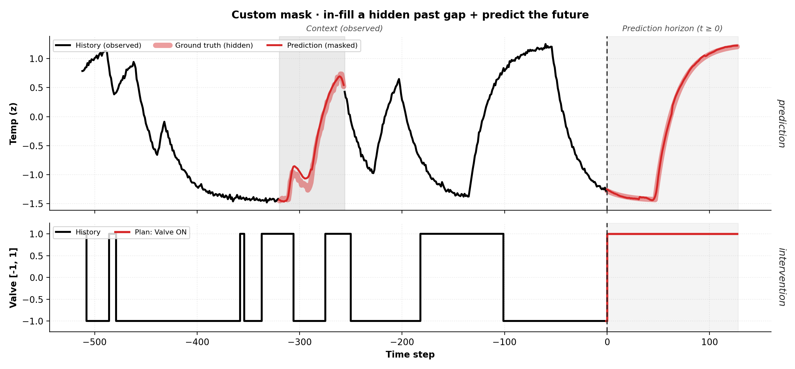</p>

Measured: gap in-fill MAE 1.85 °C against the recorded (noisy, σ=0.5) values,
future MAE 0.44 °C against the physics.

### 4. DataFrame API — `predict_df`

Long-format pandas in, long-format pandas out. Every numeric column that is
not a target is a covariate; a covariate whose future you supply in
`future_df` stays **observed** over the horizon — so passing a hypothetical
plan turns `predict_df` into the counterfactual interface:

```python
import pandas as pd
ts = pd.date_range("2024-01-01", periods=4096, freq="h")
ctx_df = pd.DataFrame({"id": "plant_A", "timestamp": ts,
                       "temp": window[1, :4096],      # target
                       "valve": window[0, :4096]})    # covariate
fut_ts = pd.date_range(ts[-1] + pd.Timedelta(hours=1), periods=128, freq="h")
future_df = pd.DataFrame({"id": "plant_A", "timestamp": fut_ts, "valve": 1.0})

pred_df = model.predict_df(ctx_df, future_df=future_df, prediction_length=128,
                           quantile_levels=[0.1, 0.5, 0.9],
                           id_column="id", timestamp_column="timestamp",
                           target="temp", graph=[("valve", "temp", 48.0)])
```

<p align="center">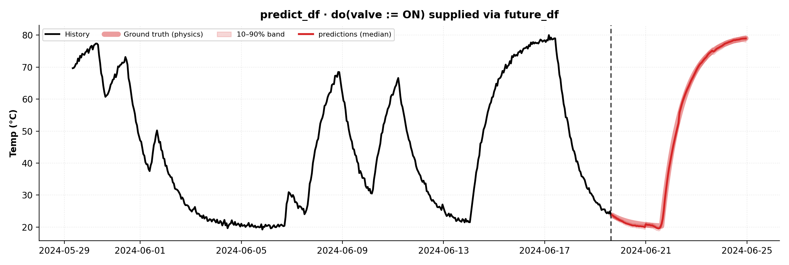</p>

The returned frame has columns
`[id, timestamp, target_column, predictions, "0.1", "0.5", "0.9"]` in raw
units; arbitrary quantile levels are interpolated from the model's nine native
levels. The prediction shows the physically correct 48-hour pre-onset decay,
then rises to 78.97 °C — the physics ends at 79.01 °C. Multiple targets
(`target=["temp", "pressure"]`), multiple systems (one `id` per plant),
missing id/timestamp columns, and arbitrary context/horizon lengths are all
supported (patch alignment is handled internally).

> **`forecast` vs `predict_df`?** Same model. `predict_df` is a pandas
> front-end: without `future_df` it calls `forecast`; with `future_df` it
> calls `what_if` (covariate futures observed, targets masked) — plus id
> grouping, timestamp handling, and quantile interpolation. The two protocols
> differ only in what the model is told about the future, which is exactly
> the difference between section 1 and section 2 above.

### 5. Forecasting — with and without a predictable future

When the dynamics are predictable, coupled variables are forecast **jointly**.
Here a smooth quasi-periodic drive and its lagged response are predicted
together — both land on the held-out truth (drive MAE 0.045, response MAE
0.55 °C):

```python
from example import make_coupled_continuous_window
cw = make_coupled_continuous_window()              # [2, 4224]: drive + response
qc = model.forecast(cw[:, :4096], 128, graph=[(0, 1, 48.0)],
                    return_quantiles=True)         # both variables, jointly
```

<p align="center">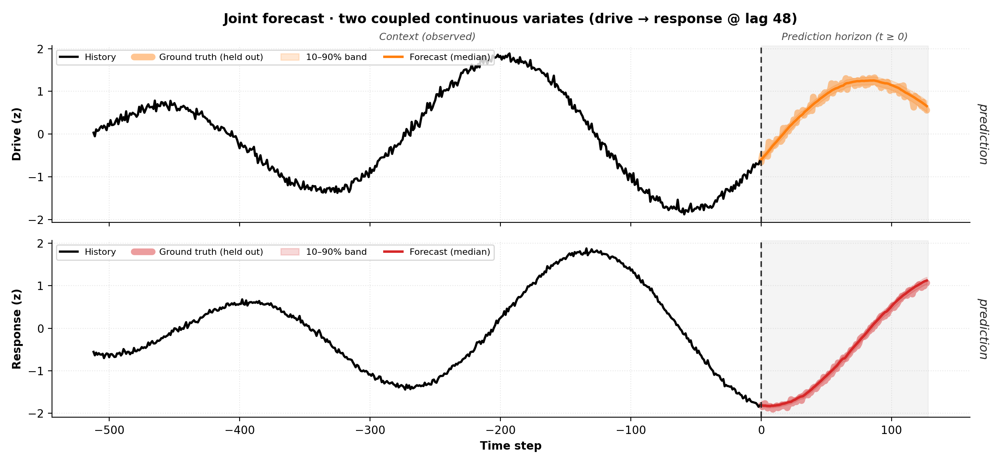</p>

The valve system is the opposite case — its future *switches* are genuinely
random, and the forecast says so:

```python
q = model.forecast(history, 128, graph=graph, return_quantiles=True)  # [2, 128, 9]
```

<p align="center">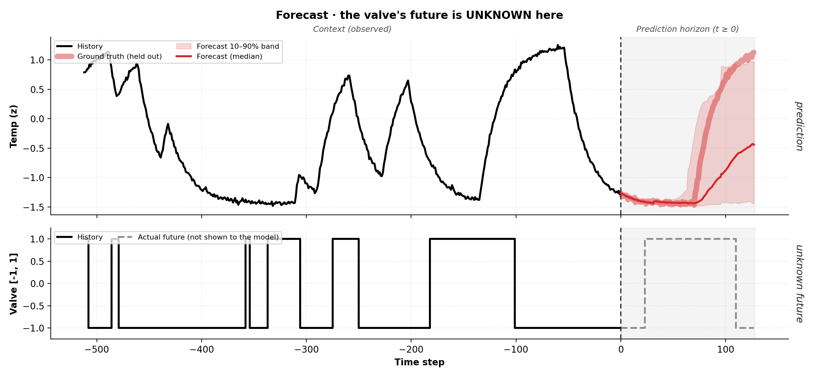</p>

The median stays cautious and the 10–90% band opens up exactly where a
switch *could* move the temperature (measured: MAE 13.1 °C, with the held-out
truth inside the band 80% of the time — matching the band's nominal 80%).
This is the honest ceiling for *forecasting* here — and exactly the gap that
the what-if conditioning of [section 1](#1-what-if--interventions-with-known-consequences)
closes: same context, but with the plan supplied, the error drops from
13.1 °C to 0.2–0.7 °C.

---

## Dissertation-scale results

The figures above are regenerated by `example.py` with the released
checkpoint. The accompanying dissertation evaluates the same protocol at
larger scale — causal cascades, dose-response identification, topology and
lag ablations, range generalization, and canonical process benchmarks. Two
samples: the full topology ablation and continuous hold-input counterfactuals
on a saturating system:

<p align="center">
  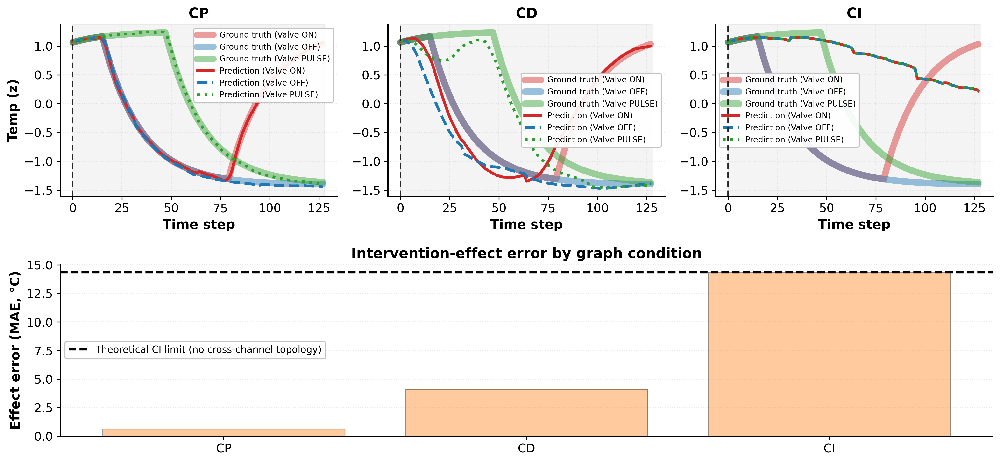
  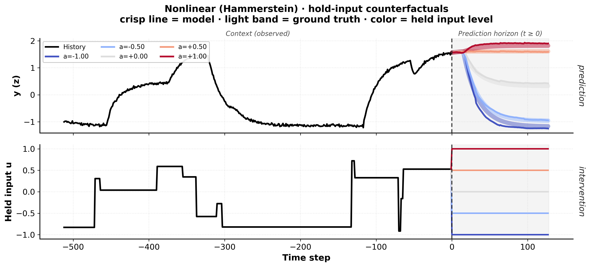
</p>

## API summary

| Call | Purpose |
|---|---|
| `PCFMPredictor.from_pretrained(repo_or_path, filename=None, device=None, runtime_discrete_revin=None)` | Load from the Hub (safetensors) or a local checkpoint file/directory. |
| `model.forecast(history, prediction_length, graph="CD", edge_lags=None, return_quantiles=False)` | Forecast all variables beyond the history. |
| `model.what_if(window, context_length, masked_nodes, graph="CD", edge_lags=None, custom_mask=None, glue=True, return_quantiles=False)` | Masked what-if inference (observed futures act as forcing). |
| `model.predict_df(context_df, future_df=None, prediction_length, quantile_levels, id_column, timestamp_column, target, graph="CD")` | Long-format pandas front-end over the two calls above. |
| `model.estimate_graph(history, top_k=10, p_value=0.05, max_lag_steps=256)` | Data-driven sparse causal graph with transport lags. |

## Model card

| | |
|---|---|
| Parameters | ~53 M (`model.safetensors`, ~211 MB fp32) |
| Width / depth / heads | 512 / 11 blocks / 8 |
| Patch size | 32 steps |
| Max context | 8192 steps |
| Output | 9 monotone quantiles (0.1–0.9) per step |
| Normalization | per-variable instance norm (asinh z-score; min-max for discrete series) |
| Graph conditioning | per-edge lagged message passing |

## Repository layout

```
model.py           the complete model + public API (single file)
example.py         the five demos above; saves example_*.png, prints all numbers
test_release.py    self-contained test suite (no checkpoint download needed)
requirements.txt   torch, numpy, huggingface_hub, safetensors (+ optional pandas, scipy, matplotlib)
figures/           the figures embedded in this README
```

## Citation

Michael Mayr and Georgios C. Chasparis. *Topologically-Constrained Any-Variate Time-Series Foundation Models for Twinning of Continuous Industrial Processes.* In: Big Data Analytics and Knowledge Discovery (DaWaK 2026), LNCS 16861, Springer, pp. 189–196. DOI: [10.1007/978-3-032-34896-8_15](https://doi.org/10.1007/978-3-032-34896-8_15)

```bibtex
@inproceedings{MayrChasparis2026,
  author    = {Mayr, Michael and Chasparis, Georgios C.},
  title     = {Topologically-Constrained Any-Variate Time-Series Foundation Models for Twinning of Continuous Industrial Processes},
  booktitle = {Big Data Analytics and Knowledge Discovery (DaWaK 2026)},
  series    = {Lecture Notes in Computer Science},
  volume    = {16861},
  pages     = {189--196},
  publisher = {Springer},
  year      = {2026},
  doi       = {10.1007/978-3-032-34896-8_15}
}
```
